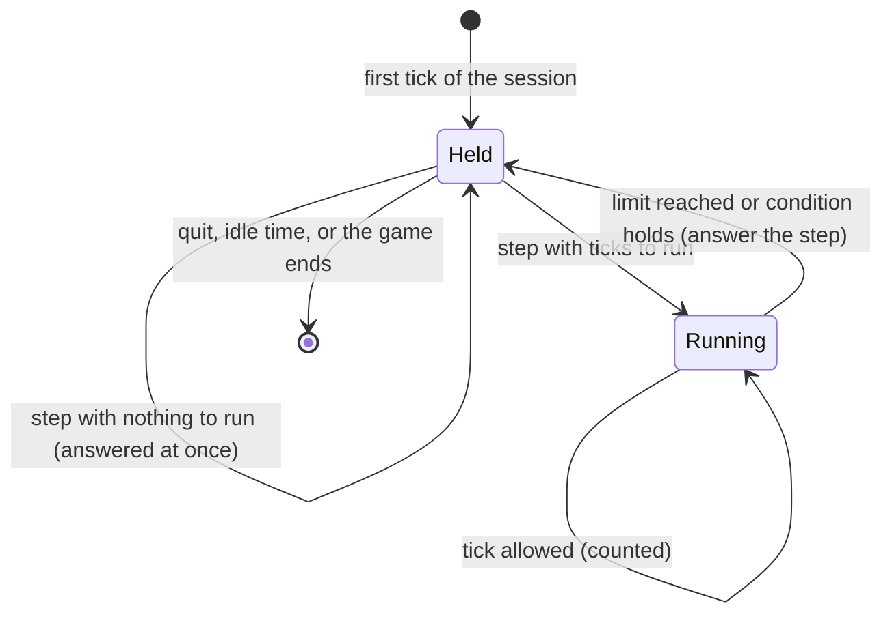

# Controlled Time and Input

**Version:** 1.0.0
**Status:** Stable
**Layer:** concept

## Overview

The game is held still between requests and advances only by an exact number of simulation ticks the driver asks for. Input reaches the game the way a device's input does. This specification fixes what "held", "exact" and "like a device" mean, so that an answer always describes the state after exactly the ticks that were asked for.

## Related Specifications

- [l1-driving-protocol.md](l1-driving-protocol.md) - Stepping and input are requests of that protocol.
- [l2-step-and-input.md](l2-step-and-input.md) - The engine realization.

## 1. Motivation

A game that runs freely while it is being observed cannot be tested reproducibly: by the time a driver reads a value, frames have passed. An agent playing a game needs to act, advance a known amount and look, with no time passing in between. Input that bypasses the engine's own input path would test a different game from the one players use.

## 2. Constraints & Assumptions

- The engine runs a fixed-rate simulation tick and a separate frame; exact stepping needs the frame rate fixed to the tick rate, which the launcher sets and declares.
- Work on other threads and on the file system is not driven by ticks and takes real time.
- The timing facts in Core Invariants were measured against a real engine; they are not derived from documentation.

## 3. Core Invariants

- **T1 Held between requests.** While no step runs, no tick, no frame, no timer and no awaited signal advances; the window is kept responsive. The game's own pause cannot stop the bridge.
- **T2 Exact ticks.** A step of N ticks lets exactly N complete ticks run, then holds again; its answer is the state after those ticks.
- **T3 Conditional steps are bounded.** A step with a condition checks it before every tick, the first included (a condition that already holds runs no tick), stops at a maximum number of ticks, and reports whether the condition was met. A condition that fails to evaluate at run time counts as not holding; one that does not parse is refused before any tick runs.
- **T4 Exactness is declared, verified and reported.** Stepping is exact only when every tick is paired with one frame. The session reports whether it is (`deterministic`) and, when it is not, why; a step that observes frames not advancing with its ticks revokes the claim for the rest of the session.
- **T5 Ticks are not paced by the clock.** A step runs its ticks as fast as the game can, so a maximum bounds ticks, not seconds. A driver waiting on threaded work gives it real time between short conditional steps instead of guessing a tick count.
- **T6 Input parity.** Injected input enters through the same engine entry point as a device's input; game code cannot tell the difference. Input is the only way in: the injector never writes the game's state.
- **T7 Measured input timing.** An injected press is seen as "just pressed" on the second tick after the hold point, so a tap lasts two ticks by default. Scheduled releases fall due by tick count; splitting one step into several must not change what the game sees. Changing these facts requires measuring again and updating the end-to-end test that pins them.
- **T8 Held input is known.** What is held can always be listed and released at once; ending a session releases everything.
- **T9 The pointer is freed while held.** Unless asked to leave it, the session makes the pointer visible each time it holds the game.

## 4. Detailed Design

### 4.1 The Hold Point



The hold point is the start of a tick, before any other part of the game runs its tick. Being there means the previous tick is complete and the next has not begun.

### 4.2 Step Counting (pseudo-code)

```plaintext
begin(limit, condition):   active = true; ticks_run = 0; until_met = false
at_tick_start():
    if not active: hold
    if condition given and condition(): until_met = true; active = false; hold
    if ticks_run >= limit: active = false; hold
    ticks_run += 1; total_ticks += 1; let the tick run
```

`total_ticks` is the clock that scheduled input releases are measured against.

## 5. Drawbacks & Alternatives

- **Unpaced ticks** make a long conditional step right after start run out before threaded loading finishes; documented for users rather than pacing ticks to the clock, which would make steps slow and non-exact.
- **Alternative: engine-wide pause**: rejected; a paused tree still runs frames, timers set to run while paused and the game's own unpause logic.

## Canonical References

| Alias | Path | Purpose |
| --- | --- | --- |
| `[STEP]` | `addons/godot_dev_bridge/runtime/step_controller.gd` | The counting behind a step. |
| `[INPUT]` | `addons/godot_dev_bridge/runtime/input_injector.gd` | Device-like input and scheduled releases. |
| `[MEASURED]` | `tests/e2e_test.rs` | Pins the measured stepping and input timing. |

## Document History

| Version | Date | Author | Description |
| --- | --- | --- | --- |
| 1.0.0 | 2026-10-16 | Agent | Initial specification reverse-engineered from the existing code. |
