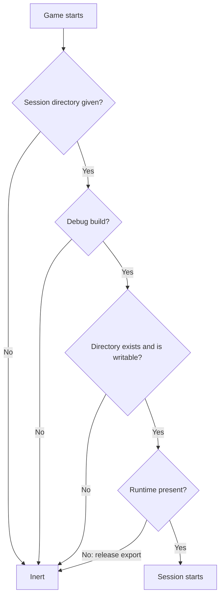

# Development-Only Safety

**Version:** 1.0.0
**Status:** Stable
**Layer:** concept

## Overview

The bridge is a command channel into a running game that can evaluate arbitrary expressions. This specification fixes the locks that keep it a development tool: it is off unless switched on at launch, never on in a release build, absent from release exports, and reachable only by the user who launched it.

## Related Specifications

- [l1-driving-protocol.md](l1-driving-protocol.md) - The channel these locks protect.
- [l2-access-and-export-locks.md](l2-access-and-export-locks.md) - The realization on each platform and in the engine's export.

## 1. Motivation

An expression evaluator inside a shipped game would let anyone who can write a file drive it, and a forgotten export filter would ship the bridge to players. The locks must hold without any configuration by the project, because the project's own developers will not remember them.

## 2. Constraints & Assumptions

- The addon is installed into arbitrary projects; it cannot rely on their export presets.
- The launching user's own account is trusted; other local accounts are not.
- An administrator of the machine is out of scope.

## 3. Core Invariants

- **D1 Off unless enabled.** The bridge stays inactive unless a session directory is given at launch. Inactive, it logs nothing, writes nothing, loads nothing further and switches its own processing off.
- **D2 Never in a release build.** The bridge is never active when the build is not a debug build, whatever the launch arguments.
- **D3 Absent from release exports.** A non-debug export leaves out the runtime, the editor-only scripts and the project adapter; only the inert entry stub ships. No export preset has to be configured for this.
- **D4 Private channel, enforced.** The session directories are usable by the launching user (and the operating system) alone. A directory that belongs to another account, or that is a link, is refused; one that is too open is tightened.
- **D5 Link-safe clearing.** Starting a session clears its directory, so session names are validated to stay below the spool root, and clearing or pruning never follows a link.
- **D6 No network.** Nothing in the bridge opens a network endpoint.
- **D7 The guards are the whole protection.** Expression evaluation can do anything the game can; it is not sandboxed. Weakening any of D1–D6 is not permitted.
- **D8 A forgotten game ends itself.** A session that receives no request for its idle time (30 minutes by default; zero disables) ends the game and records `idle`.

## 4. Detailed Design

### 4.1 Enablement Gates

Each gate is independent: a release export lacks the runtime even if a release build were somehow launched with the argument (D2 and D3 back each other up).

### 4.2 What Ships

| Part | Debug export | Release export |
| --- | --- | --- |
| Inert entry stub | yes | yes (the project's autoload list names it) |
| Runtime | yes | no |
| Editor-only scripts | yes | no |
| Project adapter | yes | no |

## 5. Drawbacks & Alternatives

- **Alternative: authentication token**: a token in a file is as private as the directory that holds it; it adds nothing over D4 and complicates every driver.
- **Drawback**: on Windows privacy depends on replacing the directory's access rules, which needs native calls; covered by platform tests in CI.

## Canonical References

| Alias | Path | Purpose |
| --- | --- | --- |
| `[STUB]` | `addons/godot_dev_bridge/dev_bridge.gd` | Enablement gates D1, D2. |
| `[EXPORT-POLICY]` | `addons/godot_dev_bridge/export_policy.gd` | What a release export leaves out (D3). |
| `[WINSEC]` | `src/winsec.rs` | Windows privacy (D4). |
| `[SESSION-DIR]` | `src/session.rs` | Private directories, clearing and pruning (D4, D5). |

## Document History

| Version | Date | Author | Description |
| --- | --- | --- | --- |
| 1.0.0 | 2026-10-16 | Agent | Initial specification reverse-engineered from the existing code. |
