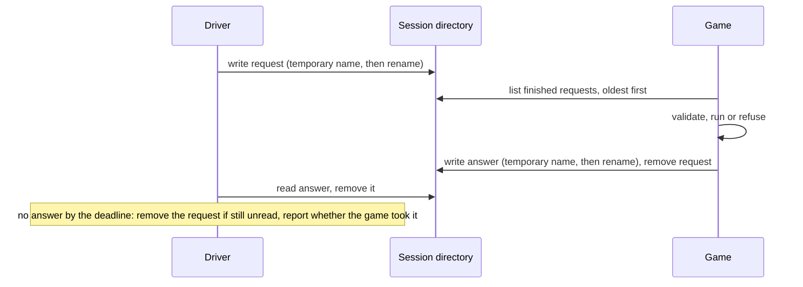
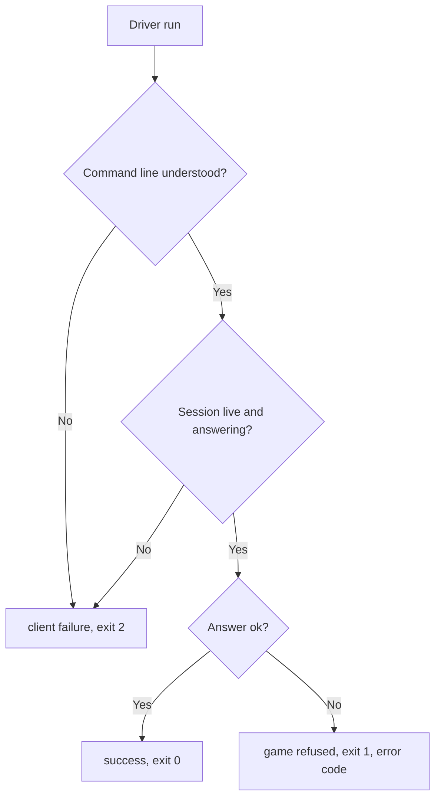

# Driving Protocol

**Version:** 1.0.0
**Status:** Stable
**Layer:** concept

## Overview

How a driver (a shell, a script or an agent) controls a running game: it writes one request at a time into a session directory the game watches, and reads back exactly one answer. This specification fixes the contract both sides keep: what a session is, how a request is exchanged, how outcomes are classified and how the contract may evolve. It knows no programming language or engine.

## Related Specifications

- [l1-controlled-time.md](l1-controlled-time.md) - The game is held still between requests; this protocol is the only thing that lets it move.
- [l1-development-only.md](l1-development-only.md) - Who may use the session directory, and when the game listens at all.
- [l1-project-extension.md](l1-project-extension.md) - Project commands and state travel through the same requests.

## 1. Motivation

A developer or an agent building a game needs to look at it and play it from the outside: start it, hold it, act, observe, stop it. A network endpoint would open a door into a process that can run arbitrary expressions, and an in-process console cannot be scripted from a shell. A directory of files is private, inspectable, scriptable from any shell and needs no server.

## 2. Constraints & Assumptions

- Each driver run is a short process that keeps nothing between runs.
- One game per session directory; one request is served at a time.
- Drivers on the same machine as the game; the directory is on a local file system that supports an atomic rename.
- Existing drivers and project adapters already depend on version 1 of this contract.

## 3. Core Invariants

- **P1 Files, not sockets.** Driver and game exchange nothing but files in one session directory. No side opens a network endpoint.
- **P2 Finished or absent.** Every file is written under a temporary name and renamed into place; a reader ignores temporary names, so a half-written file is never read.
- **P3 Every request gets an answer.** A request the game takes is answered exactly once, whether it is well formed, malformed, unknown or failing. No path leaves the driver waiting for its timeout.
- **P4 Every answer is valid JSON.** Values that JSON cannot hold (non-finite numbers, self-containing structures) are converted, not emitted.
- **P5 A failing request changes nothing.** Request values are validated before use; a request that is refused leaves the game as it was.
- **P6 Three outcome classes.** Success; the game refused the request (an error code from a closed set and a message); the driver could not start, reach or understand the session (a client failure). Each class has its own exit status: 0, 1, 2.
- **P7 A closed set of error codes.** `bad_request`, `unknown_command`, `bad_args`, `eval_failed`, `not_found`, `no_renderer`, `project_error`, `internal`, and `client` for client failures. A new code is a contract change.
- **P8 A taken request runs to completion.** A request the game has taken keeps running when its driver gives up; the driver says so in its timeout error and never retries on its own. An answer nobody collected is removed later.
- **P9 A session announces itself and says why it ended.** The game announces readiness (protocol version, identity, how it was started) before it listens, and records why it ended (`quit`, `idle` or `game`); the first reason written stands. A game that crashed or was killed records none.
- **P10 Versioned contract.** The protocol version is part of the readiness announcement. No message field, error code, verb or exit status is changed, removed or given a new meaning without a version bump. Adding an optional answer field is compatible, provided it is documented for users.
- **P11 Order.** Waiting requests are served oldest first by a sequence number that orders requests across driver runs.

## 4. Detailed Design

### 4.1 Entities

| Entity | Written by | Meaning |
| --- | --- | --- |
| Session | driver | A name and a directory that hold everything below. |
| Session record | driver | Which process the driver started, when, and with which command line. |
| Readiness announcement | game | The game is listening; protocol version and how it was started. |
| Request | driver | One command name and its arguments, named by a sequence number and an id. |
| Answer | game | The outcome of the request with the same id, plus the tick and frame counters. |
| Closing record | game | Why the session ended. |
| Log and screenshots | game | Diagnostics, kept after the game ends. |

### 4.2 Exchange

### 4.3 Outcome Classification

### 4.4 Lifecycle Verbs

Starting, stopping and listing sessions are driver-side operations, not requests: they create, end or inspect session directories. Every other verb maps one-to-one onto a request.

## 5. Drawbacks & Alternatives

- **Polling latency**: both sides poll the directory every few milliseconds. Acceptable for a development tool; a file-system notification API would differ per platform.
- **Alternative: local socket or pipe**: rejected by P1; it would need an endpoint other local users or processes could reach.

## Canonical References

| Alias | Path | Purpose |
| --- | --- | --- |
| `[USER-CONTRACT]` | `README.md` | The user-facing statement of verbs, error codes, exit statuses and session files. |
| `[CLIENT-SPOOL]` | `src/spool.rs` | Driver side of the exchange. |
| `[GAME-SPOOL]` | `addons/godot_dev_bridge/runtime/spool_transport.gd` | Game side of the exchange. |
| `[GAME-SESSION]` | `addons/godot_dev_bridge/runtime/session.gd` | Answers, outcome codes, readiness and closing records. |

## Document History

| Version | Date | Author | Description |
| --- | --- | --- | --- |
| 1.0.0 | 2026-10-16 | Agent | Initial specification reverse-engineered from the existing code (protocol 1). |
