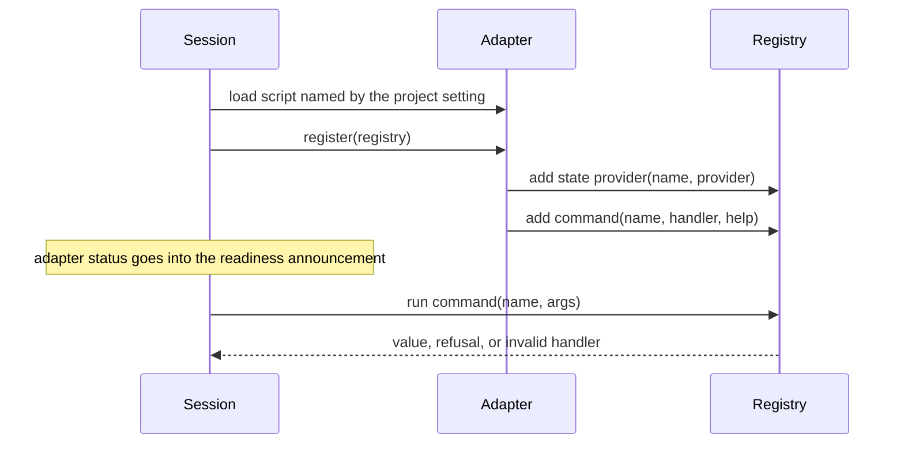

# Project Extension

**Version:** 1.0.0
**Status:** Stable
**Layer:** concept

## Overview

The bridge core is generic: it knows nothing of the game it is installed in. A project teaches it what its game can show and do through one adapter that registers named state providers and named commands. This specification fixes that boundary and the meaning of what an adapter returns.

## Related Specifications

- [l1-driving-protocol.md](l1-driving-protocol.md) - Project state and commands are read and run through its requests and answers.
- [l2-adapter-registry.md](l2-adapter-registry.md) - The realization.

## 1. Motivation

The bridge is reusable across any project only if no project's names enter the core. A game still needs domain-level reads ("the player's health") and actions ("heal") that would be awkward through raw expressions. One registration point keeps project knowledge in one place that the project owns.

## 2. Constraints & Assumptions

- The adapter is the project's code, written by people who did not write the bridge.
- The scripting language offers no exception handling: a failure inside the adapter's own code cannot be caught by the core.
- The adapter, like the runtime, is development-only and is left out of release exports.

## 3. Core Invariants

- **E1 Generic core.** Nothing in the core names a project class or project path, and the core declares no global class names (a class left in an export's class list could collide with the project's or point at a missing file).
- **E2 One entry point.** Project knowledge enters only through one adapter, named by one project setting, that exposes a single registration entry point receiving the registry.
- **E3 Two kinds of registration.** A state provider takes no arguments and returns a value; a command takes exactly one argument, the request's arguments as a dictionary, and returns a value. A registration with another shape is refused with a warning and does not register.
- **E4 Core names are reserved.** A project command cannot take the name of a core command.
- **E5 Refusal is explicit.** A command refuses its arguments only through the registry's refusal helper; the answer is then `bad_args`. Every other returned value, a dictionary with an `error` entry included, is the command's result.
- **E6 Failures inside the adapter are indistinguishable from empty results.** A handler that fails inside its own code yields an empty value, and the error goes to the game's log. The core therefore reports whether the adapter was configured, found and registered (and why not) in the readiness announcement and the status answer.
- **E7 Isolation of providers.** One provider that is missing or invalid answers an error for itself only; the others still answer.
- **E8 One conversion.** Provider and command values are converted to JSON the same way expression results are.
- **E9 Empty, not error.** A provider answers an empty value while what it reads does not exist (a menu has no player); an error is for a provider that cannot answer.

## 4. Detailed Design

### 4.1 Registration and Use

### 4.2 Outcome Mapping

| Command returns | Answer |
| --- | --- |
| the refusal helper's value | `bad_args` with its message |
| any other value (empty included) | success, value as `result` |
| handler no longer valid | `project_error` |
| unknown name | `unknown_command` |

## 5. Drawbacks & Alternatives

- **Reserved refusal key**: the refusal is recognised by a single reserved key; a command that returned exactly that key by hand would be read as a refusal. Mitigated by documenting the helper as the only way and the key as an implementation detail.
- **Alternative: an `error` entry means failure**: rejected because protocol 1 has always treated such a dictionary as a result; reinterpreting it would break existing adapters.

## Canonical References

| Alias | Path | Purpose |
| --- | --- | --- |
| `[REGISTRY]` | `addons/godot_dev_bridge/runtime/registry.gd` | Registration, refusal and outcome rules. |
| `[ADAPTER-DOC]` | `README.md` | The adapter contract as users read it. |
| `[FIXTURE-ADAPTER]` | `tests/fixtures/adapter.gd` | A working adapter used by the end-to-end tests. |

## Document History

| Version | Date | Author | Description |
| --- | --- | --- | --- |
| 1.0.0 | 2026-10-16 | Agent | Initial specification reverse-engineered from the existing code. |
