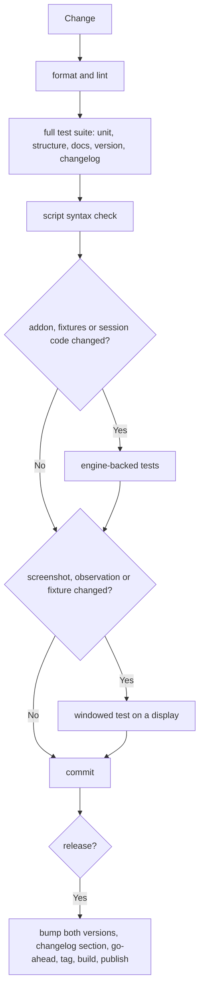

# Verification and Release

**Version:** 1.0.0
**Status:** Stable
**Layer:** concept

## Overview

How the project proves that its contract and its locks hold, and the conditions under which a version may be released. This specification fixes what must be proven automatically, against what, and which gates stand between a change and a published release.

## Related Specifications

- [l1-driving-protocol.md](l1-driving-protocol.md) - The contract the tests pin.
- [l1-controlled-time.md](l1-controlled-time.md) - The measured facts the end-to-end tests pin.
- [l1-development-only.md](l1-development-only.md) - The locks the structure and export tests prove.
- [l2-test-suite.md](l2-test-suite.md) - The tests.
- [l2-ci-release.md](l2-ci-release.md) - The pipelines.

## 1. Motivation

The bridge's most important properties (exact ticks, input timing, absence from release exports, a private channel) are invisible in normal use and break silently. Only tests against a real engine and real exports catch their regressions. A release of a client and an addon that disagree, or without notes, harms every project that installs it.

## 2. Constraints & Assumptions

- Some proofs need a real engine (a fixed minimum version); some need a display; some need a specific operating system.
- Tests that need an engine are opt-in for local runs and always run in continuous integration.

## 3. Core Invariants

- **V1 Measured facts are pinned.** Every timing fact of stepping and input is asserted by an end-to-end test against a real engine. It changes only after measuring again.
- **V2 Locks are proven, not assumed.** Each development-only lock has an automated proof: source scans for its structural rules (no network classes, no global class names, no project names, export plugin ordering, committed identity files) and a real export that shows what a release pack contains.
- **V3 Gates before every change lands.** Formatting, lint with warnings as errors, the full test suite, a syntax check of every game script, and, when the addon, the fixtures or the session code changed, the engine-backed tests; when screenshots, observation or the fixture changed, the windowed test on a machine with a display.
- **V4 Tests do not mutate the process environment.** Environment-dependent behaviour is tested through an explicit context.
- **V5 Documentation is checked.** Every verb and argument has help text and a user documentation row; a test fails without them.
- **V6 One version.** The client and the addon always carry the same version, and the changelog has a non-empty section for it.
- **V7 Release gates.** A release tag must equal that version; the release is built only after the gates pass again; its notes are the changelog section; a red build is never tagged; tagging and pushing need an explicit go-ahead from a person.
- **V8 Dependencies are audited** against a public advisory database when they change and on a schedule.
- **V9 A new behaviour has a test that failed before the change.**

## 4. Detailed Design

### 4.1 Gate Ladder

## 5. Drawbacks & Alternatives

- Engine-backed tests are slow and need a binary; keeping them opt-in locally trades local speed for CI coverage.

## Canonical References

| Alias | Path | Purpose |
| --- | --- | --- |
| `[QA]` | `AGENTS.md` | The gate pipeline contributors run, in order. |
| `[CI]` | `.github/workflows/ci.yml` | Gates on every push. |
| `[RELEASE]` | `.github/workflows/release.yml` | Release gates and publication. |

## Document History

| Version | Date | Author | Description |
| --- | --- | --- | --- |
| 1.0.0 | 2026-10-16 | Agent | Initial specification reverse-engineered from the existing code and pipelines. |
