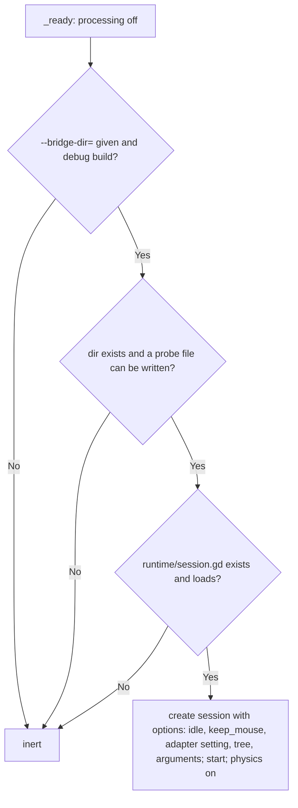

# Access and Export Locks

**Version:** 1.0.0
**Status:** Stable
**Layer:** implementation
**Implements:** l1-development-only.md

## Overview

The concrete locks: the stub's enablement checks, private session directories on Unix and Windows, session-name validation, link-safe clearing and pruning, the export plugin that keeps the runtime out of release packs, and the editor plugin that installs the stub. Open it before touching any of them; none may be weakened.

## Related Specifications

- [l1-development-only.md](l1-development-only.md) - The invariants.
- [l2-rust-client.md](l2-rust-client.md) - Where directories are created and cleared.
- [l2-step-and-input.md](l2-step-and-input.md) - The stub's processing once enabled.

## 1. Motivation

Each lock is small, but each guards a different way the bridge could reach players or other accounts; they are kept together so a change to one is reviewed against all.

## 2. Constraints & Assumptions

- Godot asks export plugins in the order of their names, and the first to skip or replace a file ends the chain; the built-in `GDScript` plugin compiles every script as soon as it is asked.
- An `EditorExportPlugin` cannot be instantiated outside the editor, so the decision rule lives in a separate testable script.

## 4. Invariant Compliance

| L1 Invariant | Implementation |
| --- | --- |
| D1 Off unless enabled | `dev_bridge.gd` switches processing off in `_ready`, then `enable()` requires `--bridge-dir=` among the user arguments; otherwise it returns with no log, file or processing. |
| D2 Debug only | `enable()` requires `OS.is_debug_build()`. |
| D3 Absent from exports | `export_policy.should_skip` skips, in non-debug exports only, everything under `<addon>/runtime/`, `plugin.gd`, `export_plugin.gd`, `export_policy.gd`, and the adapter (a `uid://` setting resolved to its path). The export plugin is named `DevBridgeExport`, which sorts before `GDScript`. The stub stays. |
| D4 Private | Unix: directories mode 0700, must be real directories owned by the user, tightened if more open. Windows (`winsec`): the DACL is replaced by full control for the user and SYSTEM, inherited inside, no inheritance from the parent; a link (symbolic link or junction) is refused, and so is a directory whose owner is not the user, the token's default owner, the Administrators group (a directory made by an elevated run) or SYSTEM. |
| D5 Link-safe | Session names: 1–64 ASCII letters, digits, `.`, `_`, `-`, not `.` or `..`. Clearing and pruning inspect `DirEntry::file_type` and never follow a link; `prune` removes only ended sessions, or a record-less leftover holding a `game.log` and only session files, unchanged for 60 s; `session.json` is removed last. |
| D6 No network | No addon script uses a networking class (structure scan). |
| D7 Guards only | `eval` is unrestricted by design; no sandbox is claimed. |
| D8 Idle end | Default 1800 s, `--bridge-idle-quit=0` disables; ends with `closed.json` `idle`. |

## 5. Detailed Design

### 5.1 Stub Enablement

### 5.2 Editor Plugin

On every editor start (Godot 4.5+ only, else it reports and does nothing) the plugin registers the adapter setting `godot_dev_bridge/adapter` with a script file picker, registers the `DevBridge` autoload pointing at the stub unless an autoload of that name points elsewhere (reported, left alone), and adds the export plugin. Disabling the plugin removes the autoload only if it is the plugin's own.

## Canonical References

| Alias | Path | Purpose |
| --- | --- | --- |
| `[STUB]` | `addons/godot_dev_bridge/dev_bridge.gd` | Enablement. |
| `[POLICY]` | `addons/godot_dev_bridge/export_policy.gd` | What a release export skips. |
| `[EXPORT]` | `addons/godot_dev_bridge/export_plugin.gd` | Feeds the policy; its name ordering. |
| `[PLUGIN]` | `addons/godot_dev_bridge/plugin.gd` | Installs the autoload, setting and export plugin. |
| `[WINSEC]` | `src/winsec.rs` | Windows access control. |
| `[SESSION-DIR]` | `src/session.rs` | Private directories, clearing, pruning. |
| `[NAME]` | `src/config.rs` | Session-name validation. |
| `[PROOF-STRUCTURE]` | `tests/structure_test.rs` | Scans for the structural rules. |
| `[PROOF-EXPORT]` | `tests/export_test.rs` | Real export of a pack. |

## Document History

| Version | Date | Author | Description |
| --- | --- | --- | --- |
| 1.0.0 | 2026-10-16 | Agent | Initial specification reverse-engineered from the existing code. |
