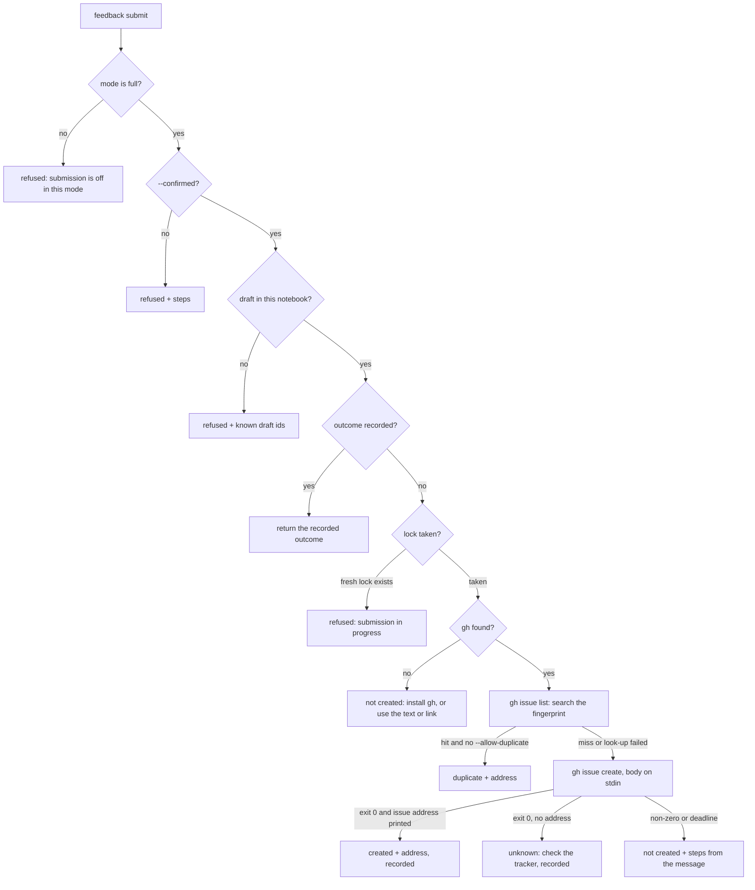

# Agent Feedback Channel (Client)

**Version:** 1.0.1
**Status:** Stable
**Layer:** implementation
**Implements:** l1-agent-feedback.md

## Overview

The Rust realization of the agent feedback channel in the command-line client: the `feedback` verb and its subcommands, the notebook files under the spool root, evidence recorded after every run, the scrubber, the report and link builders, the fingerprint, submission through the human's signed-in GitHub command-line client (`gh`), the hints added to the `start` and `stop` answers, and the two settings that control it. Open it before touching any of these.

## Related Specifications

- [l1-agent-feedback.md](l1-agent-feedback.md) - Parent concept.
- [l2-rust-client.md](l2-rust-client.md) - The run, the verb table, `Context` resolution and the conventions the channel follows (synchronous, no panics, one JSON object).
- [l2-access-and-export-locks.md](l2-access-and-export-locks.md) - Private directories and link-safe removal, reused for the notebook directory.
- [l2-wire-format.md](l2-wire-format.md) - `ready.json`, the source of the session facts and the engine version quoted in a report.
- [l2-test-suite.md](l2-test-suite.md) - Where the channel's tests join the existing targets.

## 1. Motivation

The channel touches the entry point every run passes through, the command line, the environment, the spool root, a child process and the public tracker, so a change in any of them can silently break a guarantee (a path in a report, a submission without a draft, a changed exit status of an unrelated verb). This specification maps each invariant to the code that holds it and fixes the limits and external formats that tests pin down.

## 2. Constraints & Assumptions

- No new crate dependency. The fingerprint (FNV-1a, 64 bit), percent-encoding and the scrubber are small hand-written functions; there is no regular-expression crate and none is added.
- Synchronous like the rest of the client: the `gh` child is awaited by polling with a deadline, its pipes are served by threads, and it is killed (with its process tree) at the deadline.
- `gh` is the only process the channel starts. It never inherits the client's standard output: its three standard streams are pipes, and on Windows the client first makes its own inheritable standard handles private, as it does before starting a game.
- Settings, read only in `Context::from_env` (an empty value means "not set"):

| Variable | Values | Default |
| --- | --- | --- |
| `DEV_BRIDGE_FEEDBACK` | `off`, `draft`, `full` (case-insensitive); an unknown value prints a warning on standard error and selects the default | `full` |
| `DEV_BRIDGE_GH` | Path of the `gh` executable | `gh` (`gh.exe` on Windows) found on `PATH` |

- Limits (constants in one place, each named in its rejection message):

| Item | Limit |
| --- | --- |
| Notes per notebook | 20 |
| `--summary` | 120 characters, one line |
| `--details` | 2,000 characters |
| `--suggestion` | 500 characters |
| `--verb` | the name of an existing verb |
| Drafts per notebook | 10 |
| Evidence entries | 50 per spool root (same notebook, kind, verb, code and message shape count up instead of adding) |
| Evidence message | first line only, 200 characters |
| Attempted verb or option name | 32 characters of `[A-Za-z0-9_-]`, else counted under `{invalid}` |
| Title | 100 characters |
| Report body | 24,000 characters |
| Prefilled link | 6,000 bytes in total |
| Notebook lifetime | entries unchanged for 7 days are removed when the channel next runs |
| Submission lock | stale after 120 s |
| `gh` duplicate look-up / create | 20 s / 45 s |
| `gh` output read | 1 MiB per stream |

- Assumption (forecast): the 6,000-byte link budget is below GitHub's undocumented limit with margin; it is a constant to tune after an observed 414. Runner-up: 8,000. Override: edit the constant.

## 4. Invariant Compliance

| L1 Invariant | Implementation |
| --- | --- |
| F1 Local until approved | Every file lives in `<root>/@feedback/`; the root and then that directory are created and checked with `session::ensure_private_dir` before any file is read or written (mode 0700 or the Windows owner-only rules; a link or a foreign owner is refused). The name holds `@`, which `validate_session_name` refuses, so no session can be started over it, and `sessions` and `--prune` pass over it (it has no `session.json` and no `game.log`). Files are written with `spool::write_json_atomically`; expiry and `discard` remove only regular files with the channel's own prefixes, found through `DirEntry::file_type`, and never follow a link. The only outward contact is the two `gh` calls of `feedback submit`; no feedback path calls `spool::send_request`. |
| F2 Submission separate, explicit, bound | `feedback submit DRAFT --confirmed [--allow-duplicate]` takes no text. Without `--confirmed` it refuses with the steps: show the complete draft to the human, get a yes, run again with `--confirmed`. An unknown id is refused with the notebook's draft ids. Title and body are written once, when the draft file is created. A submission first creates `draft-<id>.lock` with create-new semantics; an existing lock younger than 120 s refuses with "submission in progress", an older one is stale and is replaced. A draft whose file records `created` or `unknown` returns that outcome without starting `gh`. The lock is removed on every path out of the submission. |
| F3 Fixed destination | `owner/name` is parsed once from `CARGO_PKG_REPOSITORY`; the link builder and the `--repo` argument both read it. No feedback subcommand has an argument for a repository, host, address or credential (a test walks the subcommands' arguments). |
| F4 Scrubbed by construction | `scrub` (5.6) runs on every note field at intake, on every evidence message and attempted name at intake, on the title, and once more on the assembled body (it is idempotent). The environment block is built from the fixed list of 5.7; the death note's log tail never enters evidence, because only the first line of a message is kept. |
| F5 Bounded | The limits table is enforced at intake: notes, field lengths and drafts are refused with a message naming the limit (for notes and drafts: run `feedback discard`); the evidence directory evicts its least recently seen entry; a body over its limit halves the longest note details, repeatedly, until it fits, and says so in the report. |
| F6 Evidence apart from opinion | Report sections come from two sources and carry the labels `written by the agent` and `observed by the client` (5.7). Evidence files are written only by `feedback::observe`, called from `run`; no feedback subcommand writes one. |
| F7 One problem per issue, duplicates not filed | `fingerprint` (5.8) is computed when the draft is built and printed in the report details. `feedback submit` runs the `gh issue list` look-up for it before `gh issue create`; a hit whose body contains the fingerprint ends the call with outcome `duplicate` unless `--allow-duplicate` is given. A look-up failure is reported in the answer's `lookup` field and creation proceeds. |
| F8 A text path always exists | The draft answer always contains the report text, and the link whenever it fits 6,000 bytes (otherwise the reason). `gh` absence or failure changes only the `delivery` field; the draft stays pending and can be submitted again. |
| F9 Honest outcomes in the protocol's classes | `created` and `duplicate` answer `ok: true`, exit 0. `not_created` and `unknown` answer the usual client error (`code` `client`, exit 2) with the optional fields `outcome`, `draft` and, for `not_created`, `steps`. Created is recognized only by an issue address of this repository on `gh`'s last output line (5.9). |
| F10 Guidance in band, switch out | `Context` carries the mode. The `feedback` verb's long help holds the guidance of 5.10; the top-level help ends with one line pointing to it. In `full` and `draft` mode the `start` answer gains the optional field `feedback` (a one-line hint) and the `stop` answer gains `feedback: {pending, next}` when the notebook has notes not yet drafted. In `draft` mode `submit` is refused and no text mentions submission; in `off` mode every feedback subcommand is refused, `observe` returns at once and neither answer gains a field. |
| F11 Never in the way | `observe` runs after the run's status and object are final and receives them read-only; it returns nothing, every error inside it is discarded, and it does only bounded file work under the root (no process, no network, no request). It is skipped for the feedback verbs themselves. A test runs the same failing command with the channel `full` and `off` and compares output and status. |
| F12 One notebook per session name | Every note, draft and evidence file records the session name of its run (`--session`, `DEV_BRIDGE_SESSION`, `default`); every subcommand reads only its own name's entries. `start` clears only the session's own directory, which does not hold the notebook. |

## 5. Detailed Design

### 5.1 Module Map

```plaintext
src/
├── feedback.rs           mode, subcommand dispatch, observe(), answer hints, guidance texts
├── feedback/
│   ├── notebook.rs       files under <root>/@feedback: notes, drafts, evidence, expiry, locks
│   ├── scrub.rs          scrub, shape, fingerprint, percent-encoding (pure functions)
│   ├── report.rs         environment block, title, report body, link
│   └── issues.rs         gh runner, duplicate look-up, create, outcome mapping, repository address
├── cli.rs                + the feedback verb and its subcommands
├── config.rs             + feedback mode and gh path in Context
├── lib.rs                + dispatch, observe() after every run, hints on start and stop
└── launch.rs             handle-privacy helper shared with issues.rs
examples/
└── fake_gh.rs            stand-in for gh used by the tests; not shipped
```

### 5.2 Command Line

| Subcommand | Arguments | Answer `[REFERENCE]` |
| --- | --- | --- |
| `feedback note` | `--kind bug\|missing-feature\|improvement\|docs`, `--summary TEXT`, `--details TEXT`; optional `--verb VERB`, `--impact blocked\|workaround\|minor`, `--suggestion TEXT` | `{"ok": true, "note": "n3fa91c", "pending": [{"id", "kind", "summary"}]}` |
| `feedback list` | none | `{"ok": true, "notes": [{"id", "kind", "summary", "drafted"}], "drafts": [{"id", "title", "notes", "outcome"?, "url"?}]}` |
| `feedback draft` | optional `--notes ID,ID`, `--title TEXT` | `{"ok": true, "draft": "d81c2e0", "title", "fingerprint", "report", "link"` or `"link_reason", "delivery": {"copy": true, "link": bool, "submit": bool}, "left_out": [ids], "next": "..."}` |
| `feedback submit` | `DRAFT`, `--confirmed`, optional `--allow-duplicate` | see F9 and 5.9 |
| `feedback discard` | `IDS...` or `--all` | `{"ok": true, "removed": [ids]}` |

The global `--session` and `--timeout` apply (`--timeout` bounds nothing here: the `gh` deadlines are fixed). `feedback` with no subcommand prints its help, like every verb group. `--notes` may name notes an earlier draft used; the default is every note not yet drafted, and a draft needs at least one note (otherwise: record one with `feedback note` first). A title is scrubbed, its newlines become spaces, it is shortened to 100 characters and always starts with `[agent-feedback]` and a space; without `--title` it is `{kind}: {first summary}`. Ids are a letter (`n` note, `d` draft) and six hexadecimal digits from `spool::new_request_id`; a collision in the notebook retries.

### 5.3 Files

```plaintext
<spool root>/
└── @feedback/
    ├── note-<id>.json          {id, session, created, kind, summary, details, verb?, impact?, suggestion?}
    ├── draft-<id>.json         {id, session, created, notes, title, body, fingerprint, link?, outcome?, url?}
    ├── draft-<id>.lock         present while a submission runs
    └── evidence-<key>.json     {session, kind, verb, code, message, count, first_seen, last_seen}
```

A note is drafted when a draft of its notebook lists it. `outcome` is written only for `created` (with `url`) and `unknown`; `duplicate` and `not_created` leave the draft pending. `<key>` is the FNV-1a hash of session, kind, verb, code and message shape, so one distinct event is one file whose `count` grows; two runs updating the same file at once may lose one count, which is acceptable for a count. Every run of a feedback subcommand, and every `observe` that writes, first removes the entries unchanged for 7 days and the stale locks.

### 5.4 Observation

`run` calls `feedback::observe(ctx, argv, outcome)` once, after the outcome is known and before the object is printed. It records:

| Run | Evidence |
| --- | --- |
| A core verb answered `ok: false` (exit 1) | kind `failure`, the verb, the answer's `error.code`, the shape of the first line of `error.message` |
| A core verb failed in the client (exit 2) | kind `failure`, the verb, code `client`, the shape of the first line of the message |
| A usage error naming an unknown verb (`ErrorKind::InvalidSubcommand`) | kind `unknown_verb`, the attempted name |
| A usage error naming an unknown option (`ErrorKind::UnknownArgument`) | kind `unknown_option`, the verb it was given to, the attempted option |
| Success, `--help`, `--version`, other usage errors | nothing |

The core verbs are every verb except `feedback` itself and `do`, `state` and `raw`; these last three carry the project's own command and state names, which the parent keeps out of reports (F4 and its rejected alternative on adapter commands). Recording a usage error needs the session name, which is read from the argument list as the parser would (`--session NAME`, `--session=NAME`), else `DEV_BRIDGE_SESSION`, else `default`; an invalid name records nothing.

### 5.5 Hints on Start and Stop

| Answer | Added field `[REFERENCE]` | When |
| --- | --- | --- |
| `start` | `"feedback": "Something in godot-dev-bridge itself missing, broken or misleading? Record it as you go: godot-dev-bridge feedback note --help."` | mode `full` or `draft` |
| `stop` | `"feedback": {"pending": 2, "next": "Run godot-dev-bridge feedback draft and show the whole report to the human."}` | mode `full` or `draft` and the notebook has notes not yet drafted |

Both are optional answer fields added under P10 and documented in the README; no existing field changes. Reading the notebook for `stop` is bounded file work and its failure omits the field.

### 5.6 Scrubber

```plaintext
scrub(text, context) -> text
  1. remove control characters except newline and tab, and the bidirectional override characters
  2. replace the project directory (when known) with {project}, the notebook session's directory
     with {session} and the spool root with {root}, longest first; they match either separator
     style and, on Windows, ignore case; a match must not start or continue inside a longer name.
     The session name in single quotes (as the client's messages quote it) becomes '{session}'
  3. for each token delimited by whitespace, quotes, backticks or any of < > [ ] , ; | =
     (braces and parentheses are not delimiters, so {project}/a.gd stays one token)
     and not starting with res:// or user://:
       a Windows drive path, a UNC path, a file:// address, or a Unix absolute path with at
       least two segments or a known root (/home /Users /tmp /var /opt /mnt /private)  ->  {path}
     except node paths: /root and /root/... are the engine's scene tree and stay
     (leading parentheses and trailing punctuation stay outside the replacement)
  4. replace credential-shaped runs with {redacted}:
       a word (letters, digits, underscores, hyphens) that starts with ghp_ gho_ ghs_ ghu_
       github_pat_ sk- xoxb- xoxp- or AKIA and has at least 8 more characters, the value of
       8 or more characters after the word Bearer, and any run of 32 or more letters and digits
       that contains both a letter and a digit
  5. neutralize Markdown for the tracker:
       "@" followed by a word character  ->  "@" + zero-width space
       "#" followed by digits            ->  "#" + zero-width space + digits
       "<" -> "&lt;", "![" -> "!\["
```

The project directory is the `project` of the notebook session's `ready.json`, else the one `start` would find from the working directory, else unknown. Home directories have no rule of their own: they are absolute paths and become `{path}`, so no user or folder name survives. Placeholders use braces because angle brackets would be hidden by the tracker's sanitizer. A second pass changes nothing. Each step is a separate function, so a unit test can pin each class alone.

### 5.7 Report and Link

The environment block is built only from: the client version; the `version=` line of `<project>/addons/godot_dev_bridge/plugin.cfg` when the project is known (read-only); from the notebook session's `ready.json`, when present: `godot_version`, `headless`, `deterministic`, and `adapter.configured` and `adapter.loaded` (never `adapter.path` or `adapter.error`); whether that game is alive; `std::env::consts::OS` and `ARCH`; whether the shell rewrites paths (`MSYSTEM` set); the feedback mode. A value that cannot be read is written `unknown`.

```plaintext
build_report(notes, evidence, env) -> body
  sections as listed in the parent (4.3); each agent-written section headed "(written by the agent)",
  each client-derived section "(observed by the client)"
  all agent-written text and every quoted failure message sits inside a fenced code block whose fence
  is longer than any run of backticks in the text, so it cannot forge a heading or a label
  client-observed context = up to 5 most recent distinct failure events per verb named by a chosen note,
                              with counts
                            + for a missing-feature draft, every unknown_verb and unknown_option event
                              of the notebook (at most 10, with counts)
  report details = fingerprint, "format 1", "Drafted by an AI agent with godot-dev-bridge feedback;
                   reviewed by a human before filing. This report is public."
  if length(body) > 24,000: halve the longest note details (at a character boundary), repeat until it fits,
                            and add "(details shortened)"

build_link(title, body) -> link or reason
  base  = https://github.com/{owner}/{name}/issues/new
  query = title=<pct(title)> & body=<pct(body)>      (no other parameter)
  while length(link) > 6,000: cut the body at a character boundary and end it with
        "... (shortened; paste the full report from the conversation)"
  if even the title does not fit: no link, reason = "report too long for a link"
```

Percent-encoding leaves only unreserved characters (`A-Z a-z 0-9 - . _ ~`) unescaped.

### 5.8 Fingerprint

```plaintext
shape(message) = lowercase, digits -> "#", path-like tokens and placeholders -> "<path>",
                 whitespace collapsed, first 120 characters
key = kind of the draft
    + sorted verbs of the chosen notes
    + sorted shapes of the failure events reported in the draft
    + sorted attempted names (missing-feature drafts only)
    + (only when the three lists above are all empty) the normalized words of the first summary
fingerprint = "gdbfb" + first 12 hex digits of FNV-1a-64(key)
```

The fingerprint is one alphanumeric token, so the tracker's search treats it as a single term.

### 5.9 Submission



| Call | Arguments | Notes |
| --- | --- | --- |
| Duplicate look-up | `issue list`, `--repo {owner}/{name}`, `--state all`, `--search`, then the single argument `{fingerprint} in:body`, `--json number,title,url,body`, `--limit 5` | A hit counts only when its body contains the fingerprint; stdin is empty |
| Create | `issue create`, `--repo {owner}/{name}`, `--title={title}`, `--body-file -` | The title travels as one `--title=` argument so a leading `-` cannot be read as an option; the body is written to stdin and never to the command line; no label, assignee or other option |

Both calls run with `GH_PROMPT_DISABLED=1`, `NO_COLOR=1`, `GH_NO_UPDATE_NOTIFIER=1` and `GH_SPINNER_DISABLED=1` added to the child's environment. A created issue is recognized by a last stdout line that starts with `https://github.com/{owner}/{name}/issues/` followed by digits only. Failure steps by message: a request to log in or to set a token, so tell the human to run `gh auth login` in a terminal; a network or rate-limit message, so retry later; the deadline, so check the tracker for the fingerprint before retrying; anything else, so quote the first scrubbed line of the message. Every not-created answer also points to the text and link of `feedback draft`. A created answer repeats that the report is now public at its address.

### 5.10 Guidance

The `feedback` long help (at most 150 words) and the subcommands' help hold these points; `draft` mode's texts leave out every mention of submission:

| Point | Requirement |
| --- | --- |
| When to note | While working, as soon as a godot-dev-bridge verb, its message, its help or the README blocks or misleads the task, or a needed capability has no verb |
| What not to note | The agent's own mistakes; problems in the user's game, project or adapter; anything not observed in this work |
| How to write | English; what was tried, what came back, what was expected; name the verb when one is involved; one problem per note |
| When to draft | When the human's request has been completed or abandoned, when a `stop` answer reports pending notes, or when the human asks; one draft per problem |
| What to show | The complete report, in the conversation, in the human's language around it, then the offer: copy it, open the link, submit it, or discard it |
| Limit of authority | Never run `feedback submit` without the human's explicit yes in this conversation |

The `next` field of a draft answer repeats the last two points in that order.

### 5.11 Documentation

| File | Change |
| --- | --- |
| `README.md` | Commands row for `feedback`; a section on reporting to the maintainers (the flow, what is gathered and never gathered, the modes, the two settings); the optional `feedback` fields of the `start` and `stop` answers; the "No network" guarantee says the driving channel uses none and the only network contact is `feedback submit`, through the user's own `gh`, after the user's approval; "keeps nothing between runs" says the notebook is the one exception, kept in the private spool root |
| `.env.example` | `DEV_BRIDGE_FEEDBACK` and `DEV_BRIDGE_GH`, commented |
| `AGENTS.md` | "Using the Bridge as an Agent" gains the step: record notes as you go, draft at the end, never submit without the human's yes |
| `.github/ISSUE_TEMPLATE/agent-feedback.md` | The report headings of the parent's 4.3, for a human filing by hand |
| `CHANGELOG.md` | An `Added` entry under `[Unreleased]` |

### 5.12 Test Plan

| Behaviour | File |
| --- | --- |
| Each scrubber class, Markdown neutralization, idempotence, fingerprint stability, link budget, percent-encoding | unit tests in `src/feedback/scrub.rs`, `src/feedback/report.rs` |
| Repository address parsing, outcome mapping from `gh` output, step selection from messages | unit tests in `src/feedback/issues.rs` |
| Note intake and limits; ids; notebooks of two session names stay apart; expiry; discard; a link or foreign-owned `@feedback` refused; `sessions` and `--prune` ignore `@feedback`; `--session @feedback` refused | `tests/feedback_test.rs` |
| Draft content: scrubbed project path, root path, other absolute paths, credentials, mentions; agent text fenced; evidence of a named verb; unknown verb and option evidence in a missing-feature draft only; `do`, `state`, `raw` record nothing; the death note's log tail never recorded; environment block with and without `ready.json`; link and delivery fields | `tests/feedback_test.rs` |
| Modes: `off` refuses every subcommand and records nothing; `draft` refuses `submit` and its help never names it; an unknown mode value warns on standard error only | `tests/feedback_test.rs`, `tests/config_test.rs` |
| Consent gate: `--confirmed` missing, unknown id, a second submit returns the first outcome without starting `gh` | `tests/feedback_test.rs` |
| Submission with the stand-in `gh` (`DEV_BRIDGE_GH`): argument vector as in 5.9, body on stdin equal to the draft body, created, duplicate with and without `--allow-duplicate`, look-up failure, not signed in, `gh` missing, exit 0 without an address, deadline; a fresh lock refuses, a stale lock is replaced; the client's standard output holds only its own object | `tests/feedback_test.rs` |
| The same failing command gives the same output and exit status with the channel `full` and `off` (F11) | `tests/feedback_test.rs` |
| Every argument of every subcommand, nested ones included, has help text; the README documents `feedback`; no feedback subcommand has a repository, host, address or credential argument | `tests/docs_test.rs`, `tests/feedback_test.rs` |
| `start` carries the `feedback` hint; `stop` carries `pending` after a note and nothing without one | `tests/e2e_test.rs` |
| The stand-in: an example target (`examples/fake_gh.rs`) that is a real executable on every platform, because the standard library refuses to start a batch file with arguments it cannot escape safely; the test helper builds it once per test run, since a run that names one test target does not build examples. Its behaviour and its call records live in the directory `FAKE_GH_DIR` names, else beside the executable. Submission tests run the built client with that variable set on the child only, so no test changes its own environment; the deadline is tested on `issues::run_gh` with a short deadline and a copy of the stand-in | `tests/common/mod.rs`, `examples/fake_gh.rs` |

## 6. Implementation Notes

1. Pure functions first with their unit tests: `scrub`, `shape`, `fingerprint`, `percent_encode`, `build_link`.
2. `Context` settings, the notebook files and `feedback note`, `list`, `discard`; then `observe` in `run`.
3. `feedback draft`, the report and the environment block; then the hints on `start` and `stop` and the guidance texts.
4. The `gh` runner and `feedback submit` against the stand-in.
5. Documentation of 5.11. Maintainer one-time setup, not code: create the tracker label `agent-feedback` to apply by hand to titles with the prefix.

## 7. Drawbacks & Alternatives

- **Parsing `gh`'s output** (the issue address on the last line) depends on its human-readable format; the `unknown` outcome contains the damage if that format changes.
- **A file write on failing runs**: a run that fails now also writes a small file under the root. It is bounded (50 entries), private, expires, and can be switched off; recording only in memory is impossible for a short-lived process.
- **A regular-expression crate** would shorten the scrubber; rejected to keep the dependency list unchanged. A token-based scrubber is less exact for paths with spaces, which is acceptable because the human reviews the text.
- **One notebook per project directory** instead of per session name: rejected; feedback verbs would then need the project resolved on every run, and two agents in one project would still share it.
- **Issue form templates with prefilled fields**: deferred; how field identifiers map to link parameters is not documented in the pages checked, so the link carries only title and body.

## Canonical References

| Alias | Path | Purpose |
| --- | --- | --- |
| `[ENTRY]` | `src/lib.rs` | `run`, where `observe` and the answer hints attach |
| `[CLI]` | `src/cli.rs` | Verb definitions, help text |
| `[CONFIG]` | `src/config.rs` | `Context::from_env`, session names, project resolution |
| `[SESSION]` | `src/session.rs` | `ensure_private_dir`, listing and pruning that must pass over `@feedback` |
| `[SPOOL]` | `src/spool.rs` | Atomic writes, id generator |
| `[LAUNCH]` | `src/launch.rs` | Windows handle privacy before spawning, `start` and `stop` answers |
| `[PROCESS]` | `src/process.rs` | Process tree kill at a deadline |
| `[HELPERS]` | `tests/common/mod.rs` | Test context, temporary roots, stand-in executables |
| `[MANIFEST]` | `Cargo.toml` | Repository address and version |

## Document History

| Version | Date | Author | Description |
| --- | --- | --- | --- |
| 1.0.0 | 2026-10-16 | Agent (magic.spec) | Created with the parent concept. |
| 1.0.1 | 2026-10-16 | Agent (magic.run) | Clarified during implementation: the session directory and the quoted session name become `{session}` (client messages name both); `/root` node paths stay and `file://` addresses are paths; how the stand-in finds its behaviour without the tests changing their environment. |
