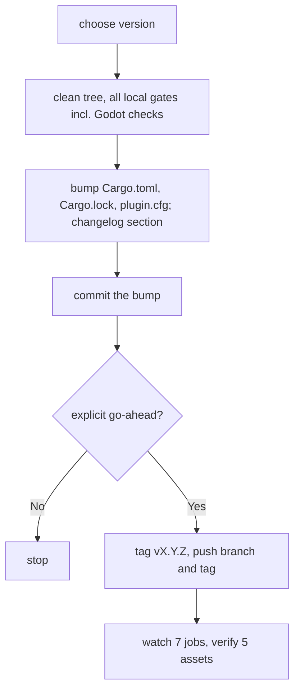

# Continuous Integration and Release

**Version:** 1.0.0
**Status:** Stable
**Layer:** implementation
**Implements:** l1-verification.md

## Overview

The GitHub Actions pipelines that run the gates on every push, audit dependencies, and build and publish a release from a version tag, plus the manual release procedure that precedes the tag. Open it before changing a workflow, a release asset or the release procedure.

## Related Specifications

- [l1-verification.md](l1-verification.md) - The gates and release conditions.
- [l2-test-suite.md](l2-test-suite.md) - The tests these pipelines run.

## 1. Motivation

Several proofs need Windows or a display, and releases ship five archives for four targets; only pipelines run all of them every time.

## 2. Constraints & Assumptions

- Godot used in CI: `4.5-stable` (the minimum supported version).
- Third-party actions are pinned by commit hash; checkouts do not persist credentials.

## 4. Invariant Compliance

| L1 Invariant | Implementation |
| --- | --- |
| V3 | `ci.yml`: `rust` job on Linux, Windows and macOS (fmt, clippy `-D warnings`, `cargo test --all-targets`, changelog check); `godot` job on Linux (import, `--check-only` of every script, engine-backed targets, window test under `xvfb-run`); `godot-windows` job (engine-backed targets, `--test-threads=2`). |
| V6 / V7 | `release.yml` on tags `v*.*.*`: `verify` (tag equals the Cargo.toml version, `release-notes.sh` finds the changelog section, fmt, clippy, tests); then `addon` (zips `addons/godot_dev_bridge`) and four `build` targets; then `publish` creates the release with the notes and every archive. |
| V7 go-ahead | The release procedure stops for an explicit confirmation before tagging and pushing; it never force-pushes or deletes tags or releases. |
| V8 | `audit.yml`: `cargo audit` when `Cargo.toml` or `Cargo.lock` change, and weekly (Monday 05:17 UTC). |

## 5. Detailed Design

### 5.1 Release Assets

| Asset | Content |
| --- | --- |
| `godot-dev-bridge-x86_64-pc-windows-msvc.zip` | client |
| `godot-dev-bridge-x86_64-unknown-linux-gnu.tar.gz` | client |
| `godot-dev-bridge-x86_64-apple-darwin.tar.gz` | client |
| `godot-dev-bridge-aarch64-apple-darwin.tar.gz` | client |
| `godot-dev-bridge-addon.zip` | `addons/godot_dev_bridge` only |

No repository file outside the client binary and the addon folder is shipped.

### 5.2 Release Procedure

A failure after the tag is pushed is fixed forward with a new patch tag.

## Canonical References

| Alias | Path | Purpose |
| --- | --- | --- |
| `[CI]` | `.github/workflows/ci.yml` | Push gates. |
| `[RELEASE]` | `.github/workflows/release.yml` | Release build and publication. |
| `[AUDIT]` | `.github/workflows/audit.yml` | Dependency advisories. |
| `[NOTES]` | `.github/scripts/release-notes.sh` | Extracts the changelog section. |
| `[PROCEDURE]` | `.agents/skills/release/SKILL.md` | The manual release steps. |

## Document History

| Version | Date | Author | Description |
| --- | --- | --- | --- |
| 1.0.0 | 2026-10-16 | Agent | Initial specification reverse-engineered from the existing pipelines. |
