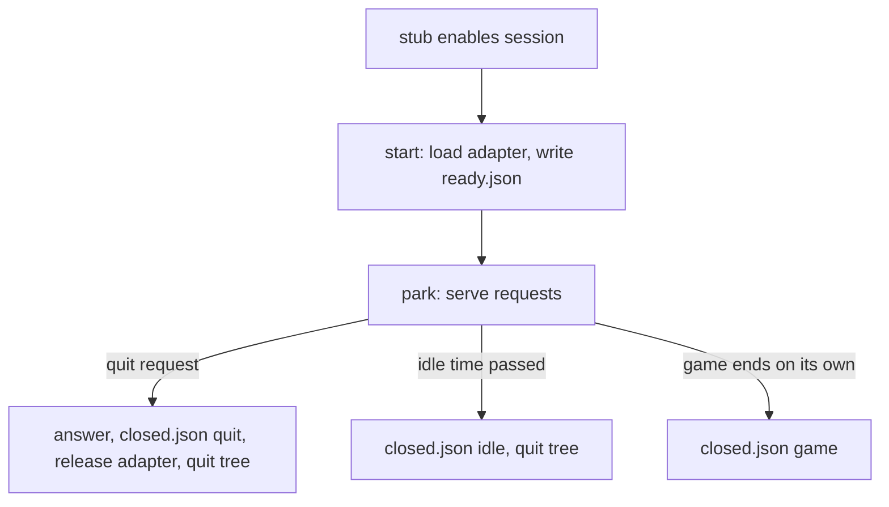

# Game Session Runtime

**Version:** 1.0.0
**Status:** Stable
**Layer:** implementation
**Implements:** l1-driving-protocol.md

## Overview

The GDScript runtime that answers requests inside the game: the session object, its dispatcher of core commands, the observer that reads the live tree, and the session's lifecycle. Open it before adding or changing a core command or anything that produces an answer.

## Related Specifications

- [l1-driving-protocol.md](l1-driving-protocol.md) - The contract.
- [l2-wire-format.md](l2-wire-format.md) - The shapes this runtime writes.
- [l2-step-and-input.md](l2-step-and-input.md) - The `step` command and the input commands' internals.
- [l2-adapter-registry.md](l2-adapter-registry.md) - Project commands and state dispatched from here.

## 1. Motivation

GDScript has no try/catch: a script error before the reply leaves the driver waiting for its timeout. The runtime is structured so that every path ends in an answer.

## 2. Constraints & Assumptions

- Godot 4.5+. Anything newer is called through `has_method()` and `call()`.
- Strict typing wherever the language allows; request values are read untyped and checked by hand, never assigned to a typed variable before the check.
- No `class_name` in any addon script; scripts reach each other by `preload` of relative paths.

## 4. Invariant Compliance

| L1 Invariant | Implementation |
| --- | --- |
| P1 | Only `spool_transport.gd` touches the file system, inside the session directory (and a `shot` path the driver names). |
| P3 | `_serve` answers every request: unreadable → retried then `bad_request`; not an object → `bad_request`; no `cmd` → `bad_request`; `args` not an object → `bad_args`; unknown name → `unknown_command`; handler result not a `Dictionary` → `internal` (`_guarded`). |
| P4 | Every result value passes through `observer.to_json`. |
| P5 | Handlers validate every argument (type, integer-ness, range) before acting and return `bad_args` otherwise. |
| P6 / P7 | Handlers return `{result}` or `{error: {code, message}}` with a code from the closed set; `_response` sets `ok`. |
| P8 | A deferred `step` is answered when it ends even if its driver has left; the answer is swept by the client later. |
| P9 | `start()` loads the adapter, then writes `ready.json`; `_close(reason)` writes `closed.json` for `quit`, `idle`, and `game` (from the stub's `_exit_tree`); `game_exiting` does nothing once the session is already quitting, so the first reason stands. |
| P11 | `pending()` sorts by sequence, then file name; one request is served at a time. |

## 5. Detailed Design

### 5.1 Core Commands

| Command | Arguments | Result / errors |
| --- | --- | --- |
| `ping` | none | `{pong: true}` |
| `status` | none | `ready.json` fields without `protocol` and `pid`, plus `renderer`, `physics_frames`, `process_frames`, `held_inputs`, `state_providers`, `commands` |
| `step` | `{ticks}` or `{until, max_ticks?}` | see l2-step-and-input; `bad_args`, `eval_failed` |
| `press`, `release`, `tap` | one of `action`/`key`/`button`, `ticks?` | `{held}`; `bad_args` |
| `release_all` | none | `{released: n}` |
| `pointer` | `x`, `y`, `relative?` | `{position}`; `bad_args` |
| `eval` | `expr` | `{value}`; `bad_args`, `eval_failed` |
| `get` | `path`, `properties?` | `{path, class, properties, missing?}`; `bad_args`, `not_found` |
| `tree` | `path?` (`/root`), `depth?` (2), `properties?` | nested `{name, class, children, child_count?}`; `bad_args`, `not_found` |
| `shot` | `path?`, `width?` (0..16384) | `{path, size}`; `no_renderer` headless; `bad_args` for an unwritable named path, `internal` for the session's own `shots/` |
| `state` | `names?` | values by provider; see l2-adapter-registry |
| `commands` | none | `{core: {name: help}, project: {name: help}}` |
| `quit` | none | `{quitting: true}`, then the game ends |

### 5.2 Observer

- Expression scope: `root`, `tree`, `bridge` (the session) and every autoload by its registered name; the scene tree's root is the base instance. The last parsed expression is cached so a condition asked every tick is parsed once; autoload names are listed once.
- `to_json`: scalars as they are; arrays, packed arrays and dictionaries element by element; vectors, quaternions, colours and rectangles as component arrays; a transform as `{origin, basis}`; a node as its absolute path; another object as `{class, id}`; anything else as its `var_to_str` text; non-finite floats as text; nesting beyond 64 levels replaced by a marker.
- `window_image` returns `null` when nothing is drawn (headless).

### 5.3 Lifecycle

A held game does not act on a quit from its own code or a window close until it is let go: the game ends with the next `step`, which is not answered.

## 6. Implementation Notes

- The adapter is freed on close when it is a `Node` outside the tree.
- `served_ids` keeps the last 64 answered ids, for diagnostics and tests.

## Canonical References

| Alias | Path | Purpose |
| --- | --- | --- |
| `[SESSION]` | `addons/godot_dev_bridge/runtime/session.gd` | Dispatcher, core commands, lifecycle. |
| `[OBSERVER]` | `addons/godot_dev_bridge/runtime/observer.gd` | Expressions, node reads, JSON conversion, screenshots. |
| `[TESTS]` | `tests/gd/session_test.gd` | Unit tests of the dispatcher. |
| `[TESTS-OBS]` | `tests/gd/observer_test.gd` | Unit tests of the observer. |

## Document History

| Version | Date | Author | Description |
| --- | --- | --- | --- |
| 1.0.0 | 2026-10-16 | Agent | Initial specification reverse-engineered from the existing code. |
