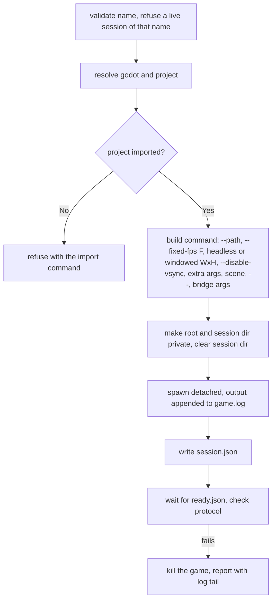

# Rust Client

**Version:** 1.0.0
**Status:** Stable
**Layer:** implementation
**Implements:** l1-driving-protocol.md

## Overview

The `godot-dev-bridge` command-line client: how it parses a command line, resolves its environment, starts and stops games, finds live sessions, sends one request and prints one JSON object. Open it before adding a verb or an argument, or changing how a game is launched.

## Related Specifications

- [l1-driving-protocol.md](l1-driving-protocol.md) - The contract.
- [l2-wire-format.md](l2-wire-format.md) - The files it writes and reads.
- [l2-access-and-export-locks.md](l2-access-and-export-locks.md) - Private directories, session names, pruning.

## 1. Motivation

A shell or an agent needs one dependency-free binary per platform whose every run is self-contained and machine-readable.

## 2. Constraints & Assumptions

- Synchronous: no async runtime. One run writes one request, polls for the answer, prints one object, exits.
- No `unwrap()` / `expect()` in production paths; errors say what to do next. Untrusted numbers are bounded before a call that panics on them.
- The environment is read in one place (`Context::from_env`); every other function takes a `Context`.
- Edition 2024, MSRV 1.85; dependencies: clap, serde, serde_json, thiserror, dotenvy; libc on Unix, windows-sys on Windows.

## 4. Invariant Compliance

| L1 Invariant | Implementation |
| --- | --- |
| P1 | Talks only through `spool::send_request` and session files. |
| P3 | Waits until the answer appears, the deadline passes or the game process dies; a dead game is reported with its closing reason and the last 40 lines of `game.log`. |
| P6 | `run` returns exit 0 for `ok: true`, 1 for an answer with `ok: false`, 2 for every `ClientError`, usage errors included (`{"ok": false, "error": {"code": "client", "message": ...}}`); `--help`/`--version` print text and no object. Diagnostics only on standard error. |
| P8 | Timeout error distinguishes "the game took the request and may still be running it" from "no answer"; nothing is retried. |
| P9 | `start` waits for `ready.json` and checks `protocol == 1`; on failure it kills the game it started. |
| P10 | `launch::PROTOCOL = 1`. |

## 5. Detailed Design

### 5.1 Verbs

| Verb | Kind | Request |
| --- | --- | --- |
| `start`, `stop`, `sessions [--prune]` | lifecycle | none (`stop` sends `quit`) |
| `status`, `ping`, `commands`, `release-all` | request | same name (`release_all`) |
| `step N` / `step --until EXPR [--max M]` | request | `step {ticks}` / `{until, max_ticks?}`; `--max` needs `--until` |
| `press`, `release`, `tap` | request | `--action`/`--key`/`--button`, `--ticks` |
| `pointer X Y [--relative]` | request | `pointer` |
| `shot [PATH] [--width W]` | request | `shot`, a relative path made absolute against the working directory |
| `eval EXPR...` | request | `eval {expr}` (words joined by spaces) |
| `get PATH [PROPS...]`, `tree [PATH] [--depth N] [--props]` | request | node paths repaired for Git Bash |
| `state [NAMES...]`, `do NAME [JSON]`, `raw JSON` | request | as given |

Global options `--session NAME` and `--timeout SECONDS` (default 30, 90 for `start`, positive and at most one year) are accepted before or after the verb. Every verb and argument has help text and a README row.

### 5.2 Context Resolution

| Value | Order |
| --- | --- |
| Spool root | `DEV_BRIDGE_ROOT`; else `<temp>/dev_bridge` (Windows, macOS); on Linux `$XDG_RUNTIME_DIR/dev_bridge` or `<temp>/dev_bridge-<uid>` |
| Session name | `--session`, `DEV_BRIDGE_SESSION`, `default` |
| Godot | `--godot`, `GODOT_PATH`, `GODOT`, `godot` on `PATH`; a `.env` file found from the working directory upwards is loaded first |
| Project | `--project`, first ancestor with `project.godot`, else the single child that has one |

### 5.3 Start

The fixed frame rate F is `--fps`, else the project's physics tick rate, else 60, and is declared to the game as `--bridge-fixed-fps=F`. On Windows the client makes its own inheritable standard handles private before spawning, so the game does not hold the caller's pipe open. The `pid` reported is the process started; `ready.pid` is the engine's.

### 5.4 Stop and Liveness

- `stop` sends `quit` (waiting at most 5 s), waits up to 5 s for the process to exit, then kills it and its whole process tree; logs are kept.
- A pid counts as the session's game only if the process was created no later than 5 s after the recorded start (a reused pid must not block a start or be killed); a Linux zombie counts as gone.

### 5.5 Git Bash Paths

Git Bash rewrites an argument starting with `/` into a Windows path under its root; `get` and `tree` strip that root again (detected through `cygpath` or `EXEPATH`).

## Canonical References

| Alias | Path | Purpose |
| --- | --- | --- |
| `[ENTRY]` | `src/lib.rs` | Run, exit statuses, timeouts. |
| `[CLI]` | `src/cli.rs` | Verbs and their one-to-one requests. |
| `[CONFIG]` | `src/config.rs` | `Context`, root, session name, Godot and project resolution. |
| `[LAUNCH]` | `src/launch.rs` | Start and stop. |
| `[SESSION]` | `src/session.rs` | Records, liveness, listing, pruning. |
| `[PROCESS]` | `src/process.rs` | Process identity and tree kill. |
| `[MSYS]` | `src/msys.rs` | Git Bash path repair. |

## Document History

| Version | Date | Author | Description |
| --- | --- | --- | --- |
| 1.0.0 | 2026-10-16 | Agent | Initial specification reverse-engineered from the existing code. |
