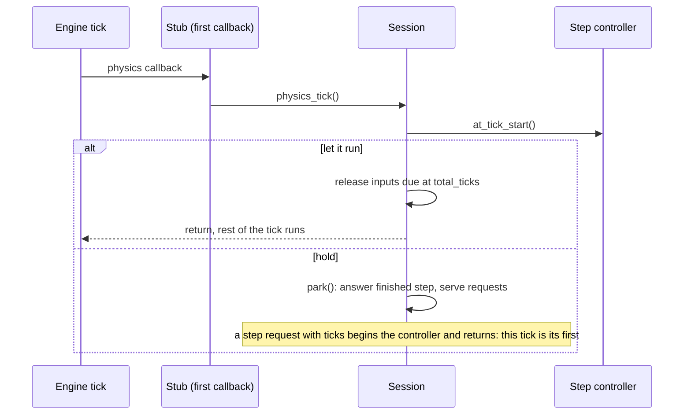

# Parked Main Loop, Stepping and Input

**Version:** 1.0.0
**Status:** Stable
**Layer:** implementation
**Implements:** l1-controlled-time.md

## Overview

How the Godot runtime holds the main loop inside a physics callback, lets exactly N ticks through, verifies that ticks and frames stay paired, and injects device-like input with tick-scheduled releases. Open it before touching the stub's processing, `step`, or any input command.

## Related Specifications

- [l1-controlled-time.md](l1-controlled-time.md) - The concept and the measured facts.
- [l2-game-session.md](l2-game-session.md) - The dispatcher that calls these parts.

## 1. Motivation

Godot has no "advance one tick" call for a running game. Blocking inside the earliest physics callback of a tick, and returning only when a step allows, gives exact control without patching the engine.

## 2. Constraints & Assumptions

- The engine is started with `--fixed-fps F` and F equals `physics_ticks_per_second`; the engine consumes `--fixed-fps` itself, so the launcher declares it again as the user argument `--bridge-fixed-fps=F`.
- Under that setting every physics tick is paired with one process frame.

## 4. Invariant Compliance

| L1 Invariant | Implementation |
| --- | --- |
| T1 Held | The stub runs at physics priority `-(1 << 30)` (first of every tick) with `PROCESS_MODE_ALWAYS`; `park()` loops `DisplayServer.process_events()`, serves requests and sleeps 2 ms, never returning to the engine while held. |
| T2 Exact ticks | `step_controller.at_tick_start()` lets exactly `limit` ticks through; the answer is written by `_complete_pending_step` at the next park. |
| T3 Bounded condition | `until` is parsed once up front (`eval_failed` if it does not parse); evaluated before every tick; default `max_ticks` 600; a run-time failure counts as false; answer carries `until_met`. |
| T4 Declared, verified | `determinism_of(arguments, ticks_per_second)` compares the declared rate; `_verify_pairing` revokes it when a finished step advanced process frames by a number other than its ticks; `ready.json`/`status` report `deterministic` and `reason`. |
| T5 Unpaced | Nothing waits on the clock between allowed ticks. |
| T6 Parity | Every event goes through `Input.parse_input_event()`; the injector reads no node and writes no game state. |
| T7 Measured timing | Tap default 2 ticks; a release scheduled at `now + ticks` falls due by `total_ticks`; the first tick of a step is counted inside `_step`, so `release_due` runs there too (a step of one tick releases what is due, and splitting a step changes nothing). Pinned by `tests/e2e_test.rs`. |
| T8 Known | `held()` lists `"<kind>:<name>"`; `release_all` on quit, idle and `release-all`. |
| T9 Pointer | `park()` sets `MOUSE_MODE_VISIBLE` unless `--bridge-keep-mouse`. |

## 5. Detailed Design

### 5.1 Tick Flow

### 5.2 Input Kinds

| Kind | Name | Event |
| --- | --- | --- |
| `action` | an InputMap action | `InputEventAction` (strength 1 or 0) |
| `key` | a key name, canonicalised (`space` becomes `Space`) so it is held and released once | `InputEventKey` (keycode and physical keycode) |
| `button` | `left`, `right`, `middle` | `InputEventMouseButton` at the pointer, with the button mask |
| pointer | `x`, `y` (finite), `relative?` | `InputEventMouseMotion` with relative motion and mask |

Exactly one of `action`, `key`, `button` per request; `ticks` must be a positive integer.

## 6. Implementation Notes

Changing the stub's priority, its process mode, the place where the first tick of a step is counted or the tap default changes measured behaviour: measure again with the end-to-end tests before and after.

## Canonical References

| Alias | Path | Purpose |
| --- | --- | --- |
| `[STUB]` | `addons/godot_dev_bridge/dev_bridge.gd` | Priority, process mode, physics callback. |
| `[SESSION]` | `addons/godot_dev_bridge/runtime/session.gd` | `physics_tick`, `park`, `_step`, pairing, determinism. |
| `[STEP]` | `addons/godot_dev_bridge/runtime/step_controller.gd` | Tick counting. |
| `[INPUT]` | `addons/godot_dev_bridge/runtime/input_injector.gd` | Events and scheduled releases. |
| `[MEASURED]` | `tests/e2e_test.rs` | The pinned facts. |
| `[FIXTURE]` | `tests/fixtures/ticker.gd` | The game that records what it saw per tick. |

## Document History

| Version | Date | Author | Description |
| --- | --- | --- | --- |
| 1.0.0 | 2026-10-16 | Agent | Initial specification reverse-engineered from the existing code. |
